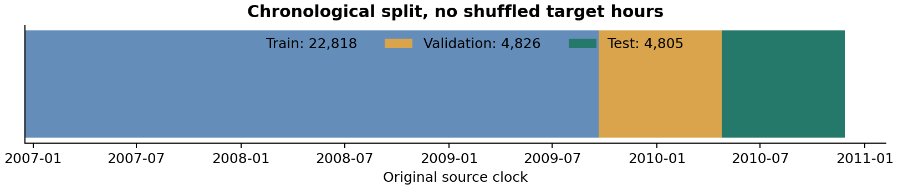
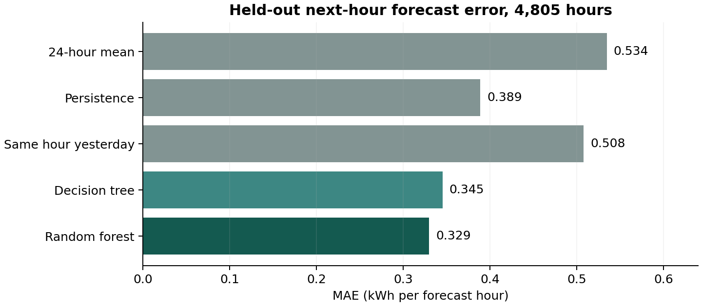
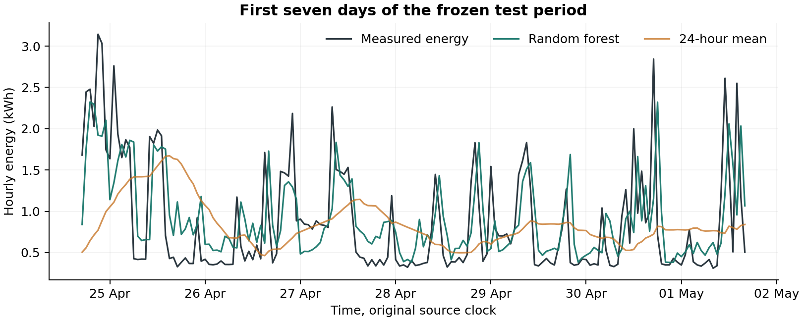
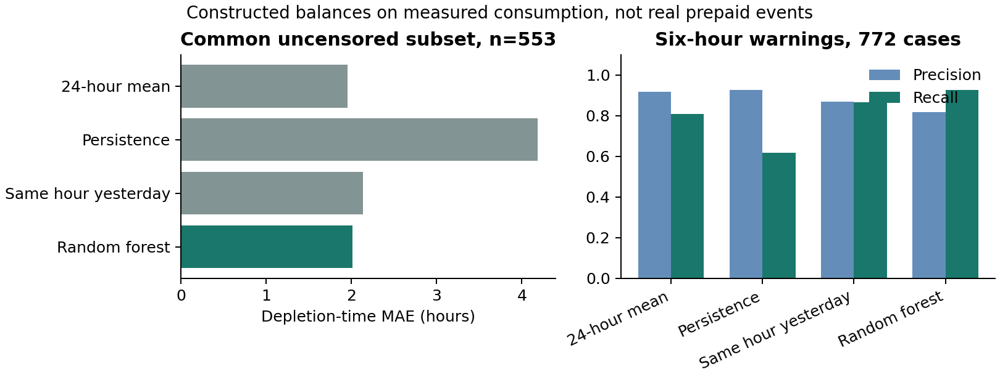

SOROTI UNIVERSITY | SCHOOL OF ENGINEERING AND TECHNOLOGY

# Electricity-demand forecasting and conditional prepaid warnings

WSN2100: Wireless Sensor Networks / IoT Capstone ProjectDeliverable 2: Baseline and Functional PrototypeDate: 6 November 2026. Submission deadline: 7 November 2026.

Davis Twinomugisha, Sarah Asingwiire, Opuche Samson and Phillip Okwany.Department of Electronics and Computer Engineering.

## 1. Revised question and scope

Can a compact model prepared for edge deployment reduce next-hour electricity-demand forecast error relative to a 24-hour consumption mean, and support conditional depletion warnings when a starting balance is independently known?

The first intended user is a landlord or caretaker managing a shared prepaid connection in Soroti. Tenants are potential beneficiaries. Commercial demand and payment willingness have not been validated. The MVP is one aggregate consumption stream and an advisory warning; per-room billing, relays, GSM and a full property portal are deferred.

## Hypothesis fixed before model fitting

H1: the validation-selected ML model reduces held-out next-hour MAE by at least 10% relative to the 24-hour mean. H0: it does not reach that practical improvement. This threshold is a project criterion, not a claim of formal preregistration. Depletion warnings are a secondary constructed-scenario analysis.

## Response to Deliverable 1 feedback

The public dataset has measured consumption but no prepaid balances or depletion labels [1]. The learned target is therefore next-hour energy in kWh. Hours remaining are calculated separately from an entered starting balance and forecast consumption, assuming no top-ups. Account names and meter numbers do not supply a balance to this software.

Current status: the data pipeline, baselines, two ML families, frozen evaluation, C exports and HTTP software demo are implemented. A sensing node, target-board execution and physical wireless evidence remain pending. The D2 hardware functional-prototype gate has not yet been passed [4].

---

# 2. Dataset and preprocessing

The full UCI Individual Household Electric Power Consumption archive contains recorded one-minute measurements from one household in Sceaux, France, December 2006 to November 2010 [1]. It is a software benchmark, not Ugandan rental data or the earlier Arduino humidity/light dataset. Only date, time and minute-averaged Global_active_power in kW are used.

| Audit item | Observed count |
| --- | --- |
| Raw minute records | 2,075,259 |
| Missing or invalid active-power entries | 25,979 |
| Hourly bins / complete hours | 34,589 / 34,085 |
| Incomplete hourly bins | 504 |
| Eligible hourly feature/target rows | 32,449 |
| Values imputed / duplicate timestamps | 0 / 0 |

The pipeline verifies the source archive SHA-256, parses and orders timestamps, rejects duplicates, and marks missing, nonnumeric, nonfinite or negative active power invalid. For each hour, energy = sum of its 60 valid minute-averaged kW values / 60. Partial or incomplete hours remain missing. Large valid loads are retained. No zero-fill, interpolation or global normalization is used.

A forecast row requires 24 consecutive complete previous hours and a complete target hour. Gaps therefore exclude both incomplete labels and subsequent histories. The original timezone-naive source clock is retained; no Uganda-time conversion or DST correction is claimed.

## Chronological partition before gap exclusion

| Partition | Eligible rows | Target-hour range |
| --- | --- | --- |
| Train | 22,818 | 17 Dec 2006 18:00 to 20 Sep 2009 12:00 |
| Validation | 4,826 | 20 Sep 2009 13:00 to 24 Apr 2010 16:00 |
| Test | 4,805 | 24 Apr 2010 17:00 to 26 Nov 2010 20:00 |

Figure 1. First 70%, next 15% and final 15% of the hourly timeline. Eligible-row percentages differ after missing-history exclusion.

Label hours do not overlap. Validation and test inputs may use earlier observed history, as in online forecasting. No future target energy enters a feature. Source attribution and transformation details accompany the redistributed CC BY 4.0 dataset [1].

---

# 3. Features, baselines and model selection

At forecast hour t, predict the energy consumed during [t, t + 1 hour). Inputs contain completed observations ending before t and calendar values known at t. Energy history is ordered oldest first. A single feature function is shared by the experiment and API; a matching C implementation is provided.

| Feature group | Definition | Count |
| --- | --- | --- |
| Energy lags | 1, 2, 3, 6, 12 and 24 hours before t | 6 |
| Moving means | Previous 3, 6 and 24 complete hours | 3 |
| Recent variation | Population standard deviation of previous 24 hours | 1 |
| Calendar | Sine/cosine of target hour and weekday; weekend flag | 5 |

## Simple baselines

The main baseline predicts the mean energy of the preceding 24 hours. Persistence predicts the last completed hour. Same-hour-yesterday predicts the observation 24 hours earlier. For multi-hour scenarios, the mean and persistence remain constant and the previous daily profile is replayed. All are causal.

## Small model families

| Model | Fixed search grid | Configurations |
| --- | --- | --- |
| Decision-tree regressor | Depth 3, 5, 7 or 9; minimum leaf 12 or 48 | 8 |
| Random-forest regressor | 16 or 32 trees; depth 6 or 8; minimum leaf 12 | 4 |

Tree regressors need no feature scaling and support direct C traversal [2, 3]. The search grid, split, seed 20261106, metrics and secondary balance assumptions were written to experiment_protocol.json before fitting. No neural model or broad automated search was necessary for this functional software milestone.

Each candidate fits training rows only. Validation MAE selects the best configuration in each family and the overall predictive winner. Family winners are then refitted on training plus validation and evaluated on the untouched test targets. The selected predictive configuration is a 32-tree forest with maximum depth 8 and minimum leaf size 12. Test data do not select hyperparameters.

## Evaluation protocol

Primary metric: MAE, in kWh per forecast hour. RMSE emphasizes larger misses; R² compares residual variance with a constant-mean reference. WAPE is total absolute error divided by total observed energy, not classification accuracy. A paired bootstrap resamples test days 2,000 times to describe uncertainty in relative MAE improvement while retaining within-day dependence.

This is one fixed chronological holdout. The bootstrap does not remove all multi-day dependence or replace validation on independent households. Repeated tuning on these test results would require a new test period.

---

# 4. Preliminary consumption results

| Method | MAE, kWh | RMSE, kWh | R² | WAPE, % |
| --- | --- | --- | --- | --- |
| 24-hour mean | 0.5344 | 0.6830 | 0.0837 | 55.99 |
| Persistence | 0.3887 | 0.5877 | 0.3216 | 40.72 |
| Same hour yesterday | 0.5078 | 0.7584 | -0.1298 | 53.20 |
| Decision tree | 0.3451 | 0.5004 | 0.5081 | 36.15 |
| Random forest | 0.3294 | 0.4758 | 0.5553 | 34.51 |

On 4,805 held-out test hours, the forest reduces MAE by 38.36% relative to the 24-hour mean and 15.24% relative to persistence. The daily-block bootstrap interval for improvement over the mean is 36.17% to 40.59%. The predeclared 10% consumption-error target is met for this source household.

Figure 2. Actual held-out next-hour errors. Lower MAE is better.

Figure 3. First seven chronological test days. Forecasts smooth some consumption peaks; a lower average error does not eliminate large misses.

The results concern future observations from the same French household. They do not establish Ugandan accuracy, separate-household generalization or prepaid-warning superiority. The forecast curve uses recorded source measurements without adding artificial sensor variation. Full predictions and additional error diagnostics are supplied as machine-readable files.

---

# 5. Conditional depletion-warning experiment

No observed prepaid labels are available. At 193 test origins spaced 24 hours apart with complete past and future coverage, assign starting balances of 2, 5, 10 and 20 kWh. This creates 772 scenarios per method. Accumulate measured future hourly energy to obtain a constructed reference crossing, and forecast energy to obtain the predicted crossing. Assume no top-ups and uniform consumption within the crossing hour.

The ML trajectory is recursive: each predicted hour becomes history for the next prediction, without using future measured values. A crossing outside 24 hours is right-censored. The next-hour errors on page 4 are not multi-hour trajectory errors.

| Method | Time MAE, h | 6 h precision | 6 h recall | Miss / false, 24 h |
| --- | --- | --- | --- | --- |
| 24-hour mean | 1.956 | 91.69% | 80.76% | 23 / 21 |
| Persistence | 4.183 | 92.68% | 61.79% | 136 / 22 |
| Same hour yesterday | 2.132 | 86.92% | 86.45% | 23 / 21 |
| Random forest | 2.010 | 81.62% | 92.68% | 1 / 56 |

Time MAE uses only the 553 scenarios with an observed constructed crossing and an in-horizon forecast crossing from every method. Of all 772 cases, 696 reference crossings occur within 24 hours. The miss/false columns report 24-hour crossing detection outside that common-subset restriction; six-hour precision and recall use all 772 assigned cases.

Figure 4. Constructed balances on measured consumption. These are not independently observed prepaid-meter events.

Interpretation: the 24-hour mean slightly beats the forest on depletion-time MAE, 1.956 versus 2.010 hours. The forest captures more six-hour events, with 342 true warnings, 77 false warnings and 27 missed warnings. The mean has 298, 27 and 71 respectively. Higher recall comes with lower precision. Earlier or more accurate real prepaid warnings have not been demonstrated.

Balances sharing one origin are dependent. Common-subset censoring affects time MAE, and event counts must accompany it. The fixed six-hour warning threshold is experimental, not a validated optimal alert policy.

---

# 6. Edge preparation and hardware handoff

The fitted models are exported to portable C tree traversal with float32 features and constants, int16 child indices and double accumulation. This is a float export, not integer quantization. A host g++ build checks predictions, and a C feature function mirrors all 15 Python features.

| Measured or checked item | Host evidence |
| --- | --- |
| Forest / compact-tree nodes | 13,024 / 249 |
| Forest / compact-tree constant arrays | 169,312 / 3,237 bytes |
| C versus Python forest comparisons | 32,449 rows; maximum difference 1.71e-07 kWh |
| C versus Python compact-tree comparisons | 32,449 rows; maximum difference 1.81e-07 kWh |
| Combined C feature and prediction checks | 150 histories; maximum feature difference 0 |
| Host batch-average inference time | 1.214 microseconds, median of 12 varied-input batches |

The host timing cycles through feature rows for 100,000 calls per batch and includes loop/index overhead. It is not ESP32 latency. Array payload is not compiled board flash or runtime RAM. The forest exceeds the aspirational 100 KB model-storage budget before linking. The lower-storage tree is supplied as an alternative; a predictive-model choice does not automatically satisfy a deployment budget.

## Prepared device software

The ESP32 sketch includes the C forest, C features and three clearly labelled recorded UCI histories. It calculates a local next-hour prediction and posts history plus prediction to the HTTP endpoint over Wi-Fi when configured. Every five seconds it replays a case; this interval is a demonstration schedule, not the source sampling rate. The sketch has not been compiled for or flashed to a target board.

## Remaining sensing-node work

Confirm the ESP32 board and an approved isolated energy-measurement interface with the laboratory supervisor. Add the actual driver, reference-meter calibration, timestamped complete-hour aggregation and a 24-hour history buffer with restart/missing-data handling. Humidity, light and motion cannot replace electrical energy measurements. Electrical connection follows the laboratory-approved installation procedure.

Measure actual board inference median/p95, compiled flash, heap usage, electrical energy cost and Wi-Fi delivery/recovery. The proposed latency target is below 100 ms per inference; it is unmeasured on hardware. Supply verified balance separately, and log all top-ups before attempting genuine prepaid-event validation.

Hardware state: no connected sensor, ESP32 execution, board resource reading or physical-radio result is claimed. The handoff guide and empty local-data templates provide the next implementation steps.

---

# 7. Functional software and IoT interface

The completed host demonstration follows recorded data, preprocessing, ML prediction and HTTP communication. The edge stage is currently verified C on a host plus a prepared ESP32 replay sketch. The local dashboard accepts 24 completed hourly kWh values and a forecast timestamp, compares baselines, plots a 24-hour trajectory and calculates a conditional warning for an entered balance.

| Interface | Function |
| --- | --- |
| GET /api/status | Model, dataset scope, metrics and hardware-pending status |
| GET /api/examples | Three recorded held-out histories with assigned balances |
| POST /api/predict | Validate history; forecast next hour and recursive 24-hour path |
| POST /api/telemetry | Require provenance; compare supplied C prediction; log replay receipt |

The server binds to 127.0.0.1:8765 by default and uses no cloud service or utility account. An ESP32 on a trusted LAN requires explicit LAN binding and configuration. This research demo does not implement authentication, TLS or a production alert service. Malformed input, nonfinite/negative values, insufficient history and oversized bodies are rejected.

| Executed software check | Result |
| --- | --- |
| Unit and HTTP integration tests | 21 passed, 0 failures, 0 errors |
| Host-loopback replay requests | 20 / 20 successful |
| HTTP request JSON body size | 533 to 548 bytes |
| Host-loopback HTTP RTT, median / p95 | 38.30 / 42.35 ms |
| Maximum C-prediction / HTTP-host difference | 2.73e-08 kWh |

RTT includes transport, parsing, Python recursive forecasting and response handling. It is distinct from edge inference time and does not measure physical Wi-Fi. Sensing/aggregation delay, feature preparation, radio association, retries and server processing can each add latency; a complete-hour model also waits for valid hourly coverage before an update.

## Supplied artifacts

The package includes source code, fitted models, executed notebook, unchanged raw archive, processed data, full validation search and test predictions, C exports, ESP32 replay source, five scientific figures, tests, demonstration guidance and the eight-page report. A local Git repository and restorable bundle are prepared. A remote GitHub URL is still to be supplied after publication.

No connected-sensor photograph, target-board benchmark or wireless measurement is included because those experiments have not occurred. Host replay must not be presented as the complete physical demonstration required by D2 [4].

---

# 8. Limitations and revised experimental plan

The primary hypothesis is supported only for next-hour errors on this historical single-household benchmark. Direct prepaid depletion labels remain absent, local validity is unknown, recursive error accumulates, and constructed warning results show a precision/recall tradeoff. No billing accuracy, utility integration, deployment reliability or commercialization claim follows from these results.

| Next experiment | Design and evidence required |
| --- | --- |
| 1. Complete the physical D2 gate | Connect and calibrate one approved energy sensor and ESP32. Demonstrate sensor/data to preprocessing, C inference, prediction and actual Wi-Fi/HTTP delivery. Keep host and board metrics separate. |
| 2. Confirm deployment budget | Compile both C alternatives; measure flash, RAM and inference median/p95. Retain the compact tree if the forest fails the agreed board budget, and report its accuracy tradeoff. |
| 3. Acquire consented local observations | Proposed pilot: one shared connection or 2-3 monitored rooms, at least four weeks of complete-hour energy if feasible. Record outages, clock convention, reference-meter checks and all missing coverage. More independent households/events may be needed. |
| 4. Establish balance ground truth | Use independently observed remaining kWh and timestamp every top-up/correction. If reliable balance access cannot be established, retain consumption forecasting as the testable primary task. |
| 5. Evaluate a later local period | Freeze models or local recalibration using earlier training/validation data. Keep the final local period untouched. Compare all baselines; report kWh errors, warning precision/recall, missed events, false warnings, lead time, censored cases and per-site results. |
| 6. Test communication and failure recovery | At least 100 physical posts with sequence IDs; record delivery, RTT, payload size, interruptions and restart behavior. Measure device electrical cost separately. |

Readiness decision: submit the completed software evidence now as a clearly bounded milestone. The hardware prototype and physical communication demonstration remain necessary to pass the complete functional-prototype gate [4]. No external GitHub submission has been made from this environment.

## References

[1] Hebrail, G. and Berard, A. (2006). Individual Household Electric Power Consumption. UCI Machine Learning Repository. https://doi.org/10.24432/C58K54. CC BY 4.0. Source and licence verified 6 November 2026.

[2] scikit-learn. DecisionTreeRegressor documentation. https://scikit-learn.org/1.8/modules/generated/sklearn.tree.DecisionTreeRegressor.html. Experiment uses scikit-learn 1.8.0.

[3] scikit-learn. RandomForestRegressor documentation. https://scikit-learn.org/1.8/modules/generated/sklearn.ensemble.RandomForestRegressor.html. Accessed 6 November 2026.

[4] Soroti University. Capstone Deliverable 2: Baseline and Functional Prototype. Supplied course brief, deadline 7 November 2026. [5] Group 2 feedback on Smart Energy Meter Deliverable 1, supplied assessment, 10.5/15.
